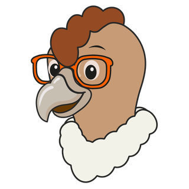
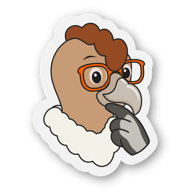
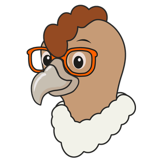
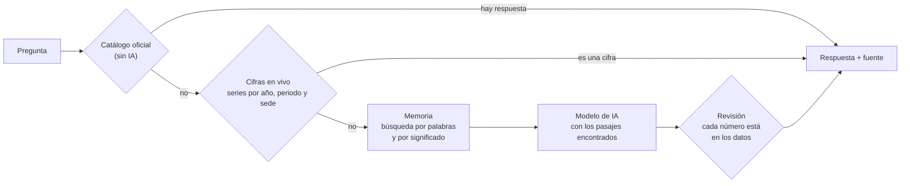

<div align="center">

<picture>
  <source media="(prefers-color-scheme: dark)" srcset="public/logo-udes-oscuro.svg">
  
</picture>

<br><br>


# Pilo AI

La inteligencia artificial de la Universidad de Santander.<br>
Responde con cifras oficiales, documentos de la universidad y la voz de Mr. Pilo.

<br>








<sub>Pilo cambia de gesto según lo que pasa en la conversación: piensa mientras busca, duda cuando no encuentra, avisa cuando algo requiere cuidado.</sub>

</div>

## Qué es

Mr. Pilo es un cóndor andino con gafas naranja, la mascota de la UDES, convertido en asistente. Una persona le pregunta en lenguaje corriente y él contesta con lo que la universidad tiene escrito, sin inventar cifras.

Hay dos Pilos, cada uno con su propia memoria, su catálogo de respuestas y su bitácora. Nunca se mezclan.

| Pilo | Para qué sirve | Ruta |
| --- | --- | --- |
| Pilo de la Universidad | Cifras, planes e impacto de la UDES | `/pregunta` |
| Pilo en Enseñanza | Enseñar y aprender: políticas, innovación y cursos de Moodle | `/pilo-ensenanza` |

## Cómo decide una respuesta

Lo que se pregunta pasa por varias etapas, de la más segura a la más abierta. La función del servidor (`supabase/functions/pilo-ia`) revisa primero lo que Planeación dejó escrito y llama al modelo de IA al final.



- El catálogo tiene dos clases de entradas: respuestas oficiales, con su fuente, y «capciosas», microexpresiones cortas que se disparan con ciertas palabras y que Pilo dice con una emoción (emocionado, atrevido, loco o pensativo).
- Las cifras en vivo guardan la serie completa de cada indicador de UDES en Cifras, así que Pilo contesta «matriculados en Cúcuta en 2023-2» con el número exacto del portal.
- La memoria se alimenta de las fuentes de cada Pilo y de los documentos que carga el personal.
- Antes de mostrar un resumen, se comprueba que cada número que menciona aparezca en los datos de los que salió.

## Qué lee cada Pilo

| Espacio | Fuentes |
| --- | --- |
| Universidad (`planeacion`) | cifras, boletines, PDI, observatorio, impacto |
| Enseñanza (`ensenanza`) | innovación, políticas, global, Moodle |

El personal también sube documentos Word, Excel, CSV y PDF de hasta 25 MB. El navegador los lee, los parte en pasajes y quedan en la memoria de su espacio, con visibilidad pública o solo para quien tenga sesión. Pilo además arma una malla de temas y relaciones entre esos documentos para entender cómo se conectan.

## Dónde vive Pilo

| Superficie | Qué es |
| --- | --- |
| `/pregunta`, `/pilo-ensenanza` | Las páginas de «Pregúntele a Pilo» |
| `/app` | La app instalable (PWA) con los dos Pilos, y un APK para Android en `public/pilo-app/apk` |
| `public/pilo.js` | Una línea de código que pone el chat de Pilo en cualquier otro portal de la universidad |
| `/pilo-embed` | El marco que carga ese chat emergente |
| `/admin` | La administración de Pilo, con sesión |
| `api/pilo-voz.js` | La voz de Pilo, en una función de Vercel que consulta Fish Audio |

El chat emergente puede leer el texto visible de la página que lo aloja, para responder sobre lo que la persona está viendo. Nunca lee campos de formulario ni lo que se marque con `data-pilo-ignorar`.

Pilo habla español, inglés y portugués.

## La app de Pilo

Estudiantes, profesores y administrativos se registran con su correo de la UDES. Con cuenta, la app ofrece:

- Respuestas guardadas y un tono personalizado: Pilo ajusta cómo habla y qué tan largo responde.
- Carnet digital con un código que cambia cada 30 segundos y que se calcula con la hora del servidor, no con la del teléfono.
- Mis clases (beta): el estudiante o profesor conecta su Moodle con su propio usuario y ve cursos, actividades y fechas de entrega. El puente es de solo lectura y no guarda nada de Moodle.
- Mis notas (beta): lo mismo con Génesis, para el histórico de notas y el polígrafo. No guarda nada y descarta los datos personales que Génesis devuelve.
- Alertas de emergencia: cuando Aluna, el sistema de emergencias del campus, declara un sismo, un incendio o un aviso de seguridad, una capa de Pilo cubre cualquier página con el aviso.

## La administración

La administración de Pilo es independiente de la intranet de Planeación. Tiene su propio acceso, su menú y un dashboard donde cada persona ve solo lo que su rol le permite abrir.

| Rol | Qué puede hacer |
| --- | --- |
| Docencia | Cargar y gestionar documentos y catálogo de Pilo en Enseñanza |
| Institucional | Cargar y gestionar documentos y catálogo de Pilo de la Universidad |
| Docencia e Institucional | Las dos cosas anteriores |
| Administrador | Todo lo anterior, más conexión con la IA, voz, portales donde aparece Pilo, cuentas de usuarios, emergencias y el personal mismo |

El personal vive en la tabla `pilo_staff`. Quien ya es administrador en PDI entra como administrador de Pilo sin necesidad de una fila. Los permisos se aplican en la base de datos con políticas de seguridad por filas, y la interfaz solo oculta lo que no corresponde.

La IA se conecta a Mistral, Free.ai, NVIDIA u otro proveedor compatible, y la voz a Free.ai, NVIDIA, Fish Audio o la del navegador. Todo se configura desde la administración.

## Base de datos

Pilo comparte el Supabase de la universidad con PDI (el proyecto `pdi-udes`). Escribe solo en sus tablas `pilo_*` y lee las de la UDES: cifras, sedes y programas.

- `supabase/migrations/` trae una copia de las migraciones `pilo_*` ya aplicadas, como historial y para las pruebas. No se vuelven a aplicar.
- Las migraciones nuevas de Pilo se crean aquí con prefijo `pilo_NNNN_nombre.sql` y se aplican a mano. Las de Planeación siguen en PDI.
- La migración `pilo_0146_staff.sql` crea el personal y los roles por espacio. Está escrita y probada como texto, pero falta aplicarla: conviene hacerlo primero en una copia de la base.
- Las funciones de `supabase/functions/` son `pilo-ia`, `pilo-cuentas`, `pilo-clases`, `pilo-genesis`, `pilo-carnet`, `pilo-alertas` y `pilo-staff`. Se despliegan con `supabase functions deploy <nombre> --no-verify-jwt`.

## Cómo correrlo

```bash
npm install
cp .env.example .env.local   # VITE_SUPABASE_URL y VITE_SUPABASE_ANON_KEY (la clave anónima, nunca la service_role)
npm run dev
npm test
npm run build
```

La clave de servicio de Supabase no debe aparecer nunca en `src/` ni en un archivo versionado. Las claves de la IA y de la voz se guardan en la base desde la administración, y la de Fish Audio se pone como variable de entorno en Vercel (`FISH_AUDIO_KEY` y `FISH_VOICE_ID`).

Stack: React 18, TypeScript, Vite, React Router, TanStack Query, GSAP, Supabase y Capacitor para la app de Android.

## Autoría

Pilo AI fue diseñado y construido en la Universidad de Santander por:

- Jose Alfredo Gutierrez Contreras, Coordinador de Inteligencia de Negocios

<div align="center">
<br>
<picture>
  <source media="(prefers-color-scheme: dark)" srcset="public/logo-udes-oscuro.svg">
  
</picture>
<br>
<sub>Universidad de Santander · Inteligencia de Negocios</sub>
</div>
