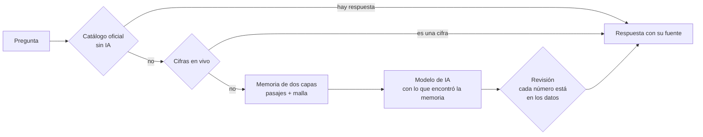
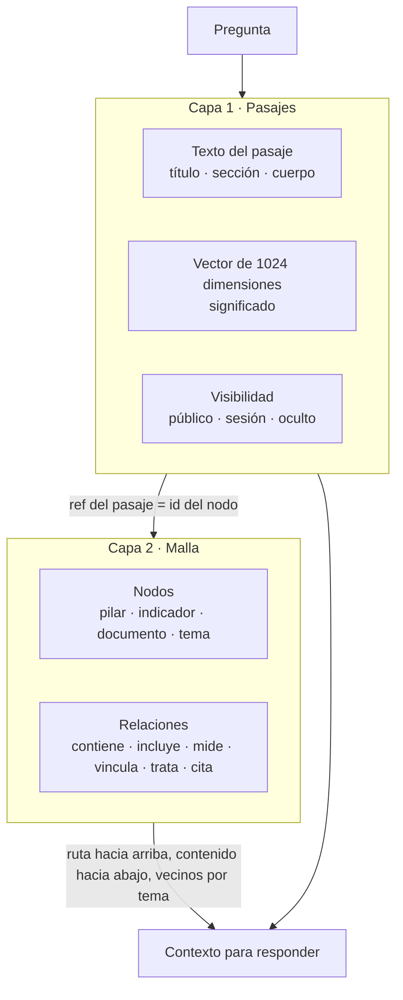
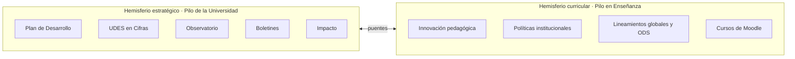

<picture>
  <source media="(prefers-color-scheme: dark)" srcset="public/logo-udes-oscuro.svg">
  
</picture>

  

# Pilo AI

La inteligencia artificial de la Universidad de Santander. 
Responde con cifras oficiales y documentos de la universidad, y muestra de dónde salió cada dato.

 

Pilo cambia de gesto según lo que pasa en la conversación: piensa mientras busca, duda cuando no encuentra, avisa cuando algo requiere cuidado.

## Qué es

Mr. Pilo es un cóndor andino con gafas naranja, la mascota de la UDES, convertido en asistente. Una persona le pregunta en lenguaje corriente y él contesta con lo que la universidad tiene escrito, sin inventar cifras.

Hay dos Pilos, cada uno pensado para un tipo de pregunta.

| Pilo | Para qué sirve | Ruta |
| --- | --- | --- |
| Pilo de la Universidad | Cifras, planes e impacto de la UDES | `/pregunta` |
| Pilo en Enseñanza | Enseñar y aprender: políticas, innovación y cursos de Moodle | `/pilo-ensenanza` |

Los dos comparten un mismo cerebro. Lo que cambia es qué parte de ese cerebro puede leer cada uno (ver [Un cerebro, dos hemisferios](#un-cerebro-dos-hemisferios)).

## Cómo decide una respuesta

Antes de llamar al modelo de IA, la pregunta pasa por etapas que cuestan menos y se equivocan menos. Se queda en la primera que responde.

Además actúan reglas fijas en la función (saludos, dinero, datos de personas y años futuros) y respuestas guardadas, que valen mientras los pasajes que citan no cambien.

El modelo de texto se configura desde la administración. Las opciones preparadas son Mistral, Free.ai y NVIDIA (con Gemma 4 31B), además de cualquier servicio compatible con el formato de OpenAI.

## La memoria de dos capas

La memoria de Pilo no es una carpeta de documentos ni un solo índice. Tiene dos capas que se consultan juntas.

| Capa | Qué guarda | Qué pregunta responde |
| --- | --- | --- |
| Pasajes | Trozos de texto con su procedencia y un vector que resume de qué hablan | ¿Qué hay escrito sobre esto? |
| Malla | Un grafo de nodos y relaciones entre esos trozos | ¿Cómo se conecta con todo lo demás? |

Los pasajes encuentran el texto. La malla le da lugar: de qué pilar, indicador o tema forma parte y qué otros pasajes hablan de lo mismo. El identificador de cada nodo de la malla es la referencia de su pasaje, así que una búsqueda que encuentra el pasaje llega directo a su sitio en la malla.

### Capa 1: los pasajes

**Cómo entran.** Los alimentan los portales de la universidad (UDES en Cifras, boletines, Plan de Desarrollo, observatorio e impacto) y los documentos que carga el personal.

Un documento se parte así antes de guardarse:

- El texto de Word o PDF se divide por títulos y cada sección se empaca en pasajes de hasta 1.500 caracteres, cortando en párrafo o frase. Los pasajes de menos de 200 caracteres se unen a un vecino.
- Una tabla de Excel, CSV o Word va por filas, cada una con el nombre de su columna («Columna: valor; …»), hasta 25 filas o 1.400 caracteres por pasaje.
- Todo texto pasa antes por tres filtros: limpieza, retirada de cifras de dinero y ocultamiento de datos personales.

**Cómo se buscan.** Cada pregunta se busca de dos maneras a la vez:

1. Por palabras. Un índice de texto completo en español, sin tildes ni mayúsculas, con tres pesos: el título pesa más que la sección y esta más que el cuerpo. Los términos se combinan con «o», así que un pasaje no necesita tener todas las palabras de la pregunta.
2. Por significado. La pregunta se convierte en un vector de 1024 dimensiones y se buscan los pasajes más cercanos por distancia coseno, sobre un índice HNSW, con un parecido mínimo de 0,3. Los vectores los calcula el proveedor de IA configurado (`nvidia/nemotron-3-embed-1b` o `mistral-embed`). Un vector se da por vencido si no existe, si lo calculó otro modelo o si el texto cambió después.

Por significado, «¿cuántos se fueron de la universidad?» encuentra el indicador «tasa de deserción», aunque no comparta ninguna palabra con la pregunta.

**Cómo se funden.** Las dos listas se combinan con fusión de rangos recíprocos: cada lista aporta 1 / (60 + puesto) a cada pasaje, y uno que aparece en las dos suma ambos aportes. Gana quien queda arriba en las dos, y el resultado queda marcado como encontrado por «palabras», por «significado» o por «ambas».

**Cifras en vivo.** Los indicadores de UDES en Cifras tienen su propia tabla, con la serie completa por año, periodo y sede, y también un vector. Así Pilo contesta «matriculados en Cúcuta en 2023-2» con el número exacto del portal, sin pasar por un resumen.

### Capa 2: la malla

La malla es un grafo dirigido. Sus nodos son las cosas de las que hablan los pasajes y sus aristas son las relaciones entre ellas.

**Qué nodos tiene.**

| Fuente | Estructura del nodo |
| --- | --- |
| Plan de Desarrollo | Pilar › Área estratégica › Línea de acción › Proyecto, con la numeración del Mapa numerado (P1, AE3, LA12, PR4) |
| UDES en Cifras | Informe › indicador |
| Observatorio | Tema › tabla |
| Documentos de Enseñanza | Colección › documento › sección, más temas y referencias (una ley, un ODS, una organización) |

**Qué relaciones tiene.**

| Relación | Une | Quién la pone |
| --- | --- | --- |
| `contiene` | Un nodo con cada uno de los que tiene dentro: es la estructura de la fuente | Reglas, sin IA |
| `incluye` | Un nodo con las piezas que incluye, por ejemplo un informe | Reglas, sin IA |
| `mide` | Un nodo con aquello que mide | Reglas, sin IA |
| `vincula` | Dos nodos que se vinculan entre sí | Reglas, sin IA |
| `trata` | Un pasaje con un tema | La IA, al comprender |
| `cita` | Un pasaje con una referencia | Reglas o IA |

Cada relación guarda quién la puso, «reglas» o «ia». Por eso rehacer lo que hizo la IA no borra la estructura que sale de las reglas.

**Cómo se construye.** La estructura de un documento sale sin IA, de sus títulos y de las referencias que se reconocen por forma. Después viene el paso «Comprender»: la IA lee los pasajes en lotes de 36 y propone hasta 6 temas y 5 referencias por pasaje. Se le muestran 200 temas que ya existen para que reutilice uno antes de crear otro, y así la malla no se llena de temas casi iguales con nombres distintos. Un pasaje queda pendiente de comprender si nunca se procesó o si cambió después de su última lectura.

**Cómo se usa al responder.** Con los pasajes que encontró la búsqueda, Pilo recorre la malla de dos maneras:

- Alrededor de un nodo: sube por su ruta hasta 6 niveles (el tope es 10) y baja a lo que contiene, 1 nivel por omisión (el tope es 4). Así sabe que un proyecto pertenece a una línea, a un área y a un pilar.
- Por vecinos: trae los pasajes que comparten tema o referencia con los encontrados. Un documento de políticas y otro de lineamientos se tocan porque ambos citan, por ejemplo, el ODS 4.

Opcionalmente las relaciones viajan al modelo en un bloque aparte, `[RELACIONES]`, con las conexiones que ya existen para las fuentes de esa pregunta. Está apagado de partida, y mientras lo esté el pedido es idéntico al de siempre.

## Un cerebro, dos hemisferios

Pilo tiene una sola memoria. Cada portal es una vista sobre ella, y qué ve cada uno lo decide una matriz de portales por fuentes.

En la matriz, cada celda dice cómo lee un portal una fuente:

| Valor | Qué significa |
| --- | --- |
| `casa` | La fuente es del ámbito de ese portal: se busca siempre y se cita sin aclaración |
| `visita` | La fuente es de otro ámbito: se lee solo cuando lo de casa no alcanza, o por un puente aprobado |
| `no` | Ese portal no la lee |

La matriz nace con la separación de siempre: cada portal lee solo sus fuentes encendidas. La lectura de visita empieza apagada, y la administración la enciende celda por celda.

**Puentes.** Un puente es una relación entre dos ámbitos, con estado: propuesta, aprobada o rechazada. Se calculan de dos maneras:

- Por reglas: la misma referencia en los dos lados (un ODS, una norma con su número) o el mismo nombre de un punto del Plan de Desarrollo. Estos se aprueban solos.
- Por tema compartido: lo propone la IA y la administración lo aprueba o rechaza uno por uno. Lo rechazado no vuelve a aparecer.

**Quién puede leer qué.** La visibilidad viaja con el pasaje y siempre se respeta, tanto en casa como de visita:

- Un pasaje oculto no lo lee nadie.
- Uno marcado «con sesión» solo lo lee el personal con sesión de la intranet.
- Impacto pide sesión.
- Moodle no sale de su portal, aunque una celda o un puente digan otra cosa.

Las búsquedas de siempre, por palabras, por significado y por malla, siguen leyendo solo lo de casa. Por eso una respuesta guardada que citara un pasaje de visita nunca se considera fresca, y la función no la guarda.

## Cómo aprende

Lo que Pilo no supo responder no se pierde. Llega a una bandeja de la administración por tres motivos:

| Entrada | Cuándo se crea |
| --- | --- |
| `sin_respuesta` | No encontró nada en lo publicado |
| `no_sirvio` | La persona marcó «No me sirvió» |
| `revisar` | La IA redactó con una cifra que no está en las fuentes |

La misma pregunta, normalizada, suma veces en vez de repetirse, y así se ve qué se pregunta más. Planeación escribe la respuesta, entra al catálogo y desde ese momento Pilo la da primero, sin IA. El catálogo también se indexa por significado, de modo que Pilo la reconoce aunque la pregunten con otras palabras.

Las preguntas capciosas (las que dan por cierto algo que no lo es) siguen un camino parecido. La IA propone, una sola vez, la premisa falsa que la pregunta asume y lo que es cierto. La administración la edita y la aprueba, y solo lo aprobado llega al pedido del modelo. Si la capciosa cambia, su premisa vuelve a ser propuesta y hay que revisarla otra vez. Esta función también viene apagada de partida.

## Qué lee cada Pilo

| Espacio | Fuentes |
| --- | --- |
| Universidad (`planeacion`) | cifras, boletines, PDI, observatorio, impacto |
| Enseñanza (`ensenanza`) | innovación, políticas, global, Moodle |

El personal sube documentos Word, Excel, CSV y PDF de hasta 25 MB. El navegador los lee, los parte en pasajes y quedan en la memoria de su espacio, con visibilidad pública o solo para quien tenga sesión.

## Dónde vive Pilo

| Superficie | Qué es |
| --- | --- |
| `/pregunta`, `/pilo-ensenanza` | Las páginas de «Pregúntele a Pilo» |
| `/app` | La app instalable (PWA) con los dos Pilos, y un APK para Android en `public/pilo-app/apk` |
| `public/pilo.js` | Una línea de código que pone el chat de Pilo en cualquier otro portal de la universidad |
| `/pilo-embed` | El marco que carga ese chat emergente |
| `/admin` | La administración de Pilo, con sesión |
| `api/pilo-voz.js` | La voz de Pilo, en una función de Vercel que consulta Fish Audio |

El chat emergente puede leer el texto visible de la página que lo aloja, para responder sobre lo que la persona está viendo. Nunca lee campos de formulario ni lo que se marque con `data-pilo-ignorar`.

La interfaz está en español, inglés y portugués.

## La app de Pilo

Estudiantes, profesores y administrativos se registran con su correo de la UDES. Con cuenta, la app ofrece:

- Respuestas guardadas y un tono personalizado: Pilo ajusta cómo habla y qué tan largo responde.
- Carnet digital con un código que cambia cada 30 segundos y que se calcula con la hora del servidor, no con la del teléfono.
- Mis clases (beta): el estudiante o profesor conecta su Moodle con su propio usuario y ve cursos, actividades y fechas de entrega. El puente es de solo lectura y no guarda nada de Moodle.
- Mis notas (beta): lo mismo con Génesis, para el histórico de notas y el polígrafo. No guarda nada y descarta los datos personales que Génesis devuelve.
- Alertas de emergencia: cuando Aluna, el sistema de emergencias del campus, declara un sismo, un incendio o un aviso de seguridad, una capa de Pilo cubre cualquier página con el aviso.

## La administración

La administración de Pilo es independiente de la intranet de Planeación. Tiene su propio acceso, su menú y un dashboard donde cada persona ve solo lo que su rol le permite abrir.

| Rol | Qué puede hacer |
| --- | --- |
| Docencia | Cargar y gestionar documentos y catálogo de Pilo en Enseñanza |
| Institucional | Cargar y gestionar documentos y catálogo de Pilo de la Universidad |
| Docencia e Institucional | Las dos cosas anteriores |
| Administrador | Todo lo anterior, más conexión con la IA, voz, portales donde aparece Pilo, cuentas de usuarios, emergencias y el personal mismo |

El personal vive en la tabla `pilo_staff`. Quien ya es administrador en PDI entra como administrador de Pilo sin necesidad de una fila. Los permisos se aplican en la base de datos con políticas de seguridad por filas, y la interfaz solo oculta lo que no corresponde.

La voz puede salir de Free.ai, NVIDIA, Fish Audio o del navegador. Todo se configura desde la administración.

## Base de datos

Pilo comparte el Supabase de la universidad con PDI (el proyecto `pdi-udes`). Escribe solo en sus tablas `pilo_*` y lee las de la UDES: cifras, sedes y programas.

- `supabase/migrations/` trae una copia de las migraciones `pilo_*` ya aplicadas, como historial y para las pruebas. No se vuelven a aplicar.
- Las migraciones nuevas de Pilo se crean aquí con prefijo `pilo_NNNN_nombre.sql` y se aplican a mano. Las de Planeación siguen en PDI.
- La migración `pilo_0146_staff.sql` crea el personal y los roles por espacio. Está escrita y probada como texto, pero falta aplicarla: conviene hacerlo primero en una copia de la base.
- Las funciones de `supabase/functions/` son `pilo-ia`, `pilo-cuentas`, `pilo-clases`, `pilo-genesis`, `pilo-carnet`, `pilo-alertas` y `pilo-staff`.

## Tecnología

React 18, TypeScript, Vite, React Router, TanStack Query y GSAP en el cliente. Supabase con Postgres, pgvector y Edge Functions en el servidor. Capacitor para la app de Android.

## Autoría

Pilo AI fue diseñado y construido en la Universidad de Santander por:

- Jose Alfredo Gutierrez Contreras, Coordinador de Inteligencia de Negocios

 
<picture>
  <source media="(prefers-color-scheme: dark)" srcset="public/logo-udes-oscuro.svg">
  
</picture>
 
Universidad de Santander · Inteligencia de Negocios

